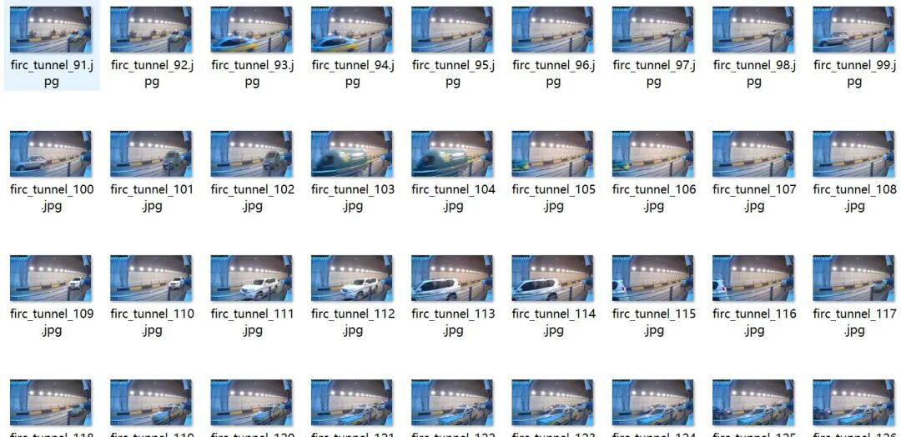
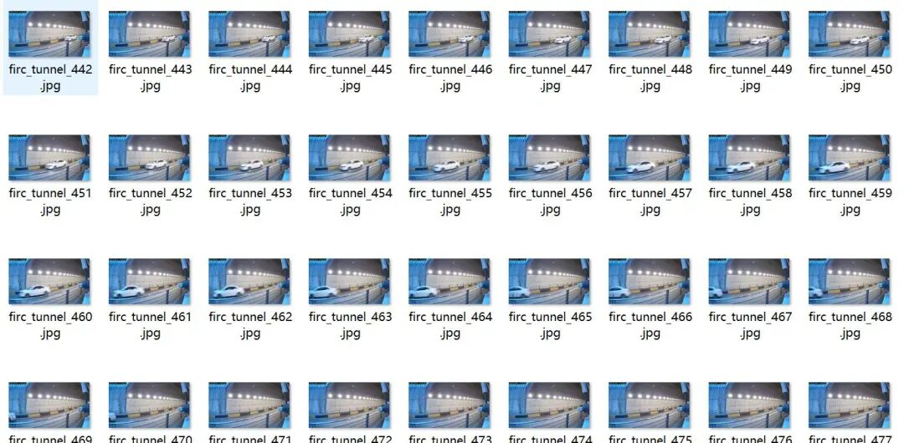
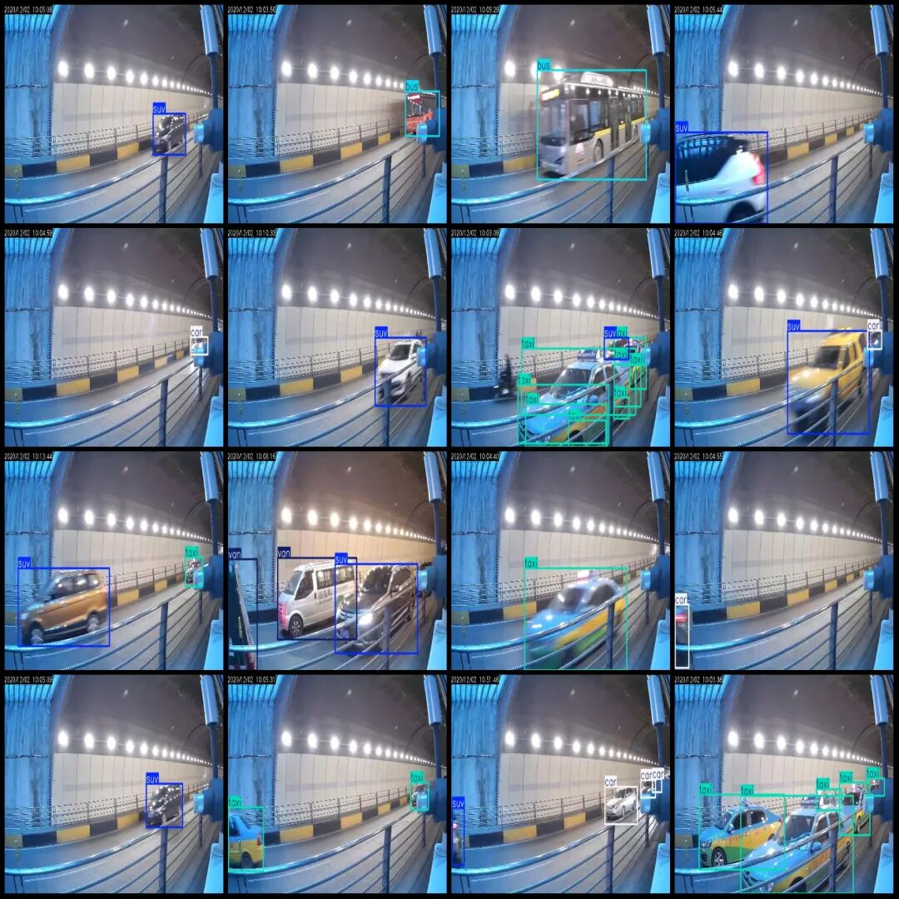
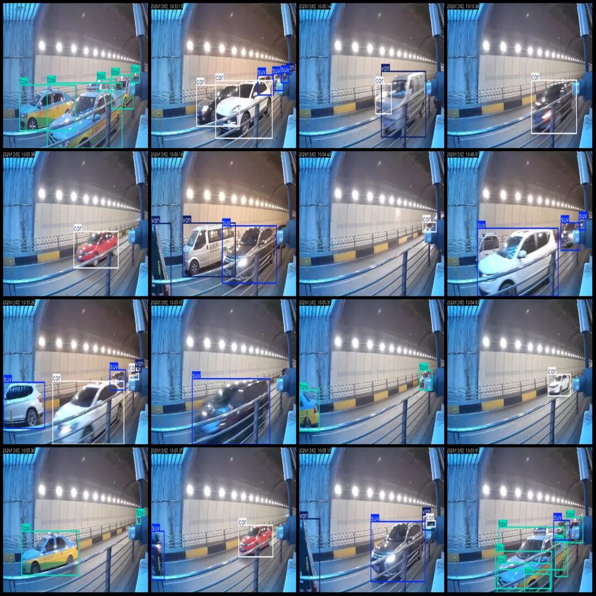

# Vehicle Detection Dataset for Highway Tunnels in VOC+YOLO format with 2088 images across 6 categories

Dataset format: Pascal VOC format + YOLO format (txt file without split path, only containing jpg images and corresponding VOC format xml files and yolo format txt files)

Number of images (number of jpg files): 2088

Number of annotations (number of xml files): 2088

Number of annotations (number of txt files): 2088

Label count: 6

Label category names (note that the order of yolo format categories does not correspond to this, but is based on the classes.txt in the labels folder): ["bus", "car", "suv", "taxi", "truck", "van"]

Number of boxes labeled in each category:

Bus (bus) frame count = 88

Car (sedan) frame count = 1541

SUV (SUV) frame count = 1325

Taxi (taxi) frame count = 981

Truck (truck) frame count = 11

Van (Bakery/Truck) Frame Count = 829

Total frame count: 4775

Number of images per category:

Bus (bus) occupies the image count = 82

car (small car) occupies the image count = 1164

SUV (Sport Utility Vehicle) accounted for = 1025

Taxi (taxi) occupies the image count = 550

Truck (truck) occupies the image count = 11

Van (Bakery/Truck) occupies the image count = 523

Image resolution: 640x362

Using labelImg:

Annotation rules: Draw a rectangle around the category.

Important Notice: The dataset does not have separate training, validation, and test sets; you need to partition them yourself.

Special : This dataset does not guarantee the accuracy of the trained models or weight files.

Image Preview:

Annotation example:

## Payment

Here is a pay link on Stripe ( https://buy.stripe.com/3cs8yP7sY87d0vu9AB ). Please contact me lonlonago@foxmail.com after funding $89, and I will send you a complete data files , thank you!

